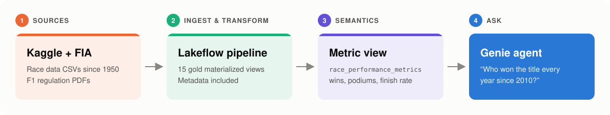
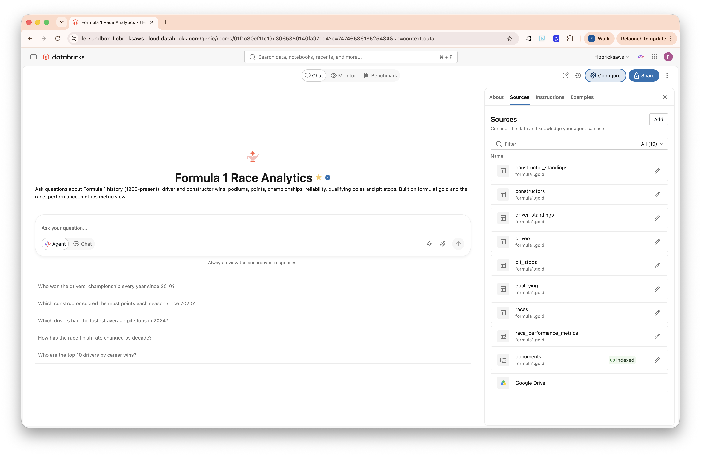
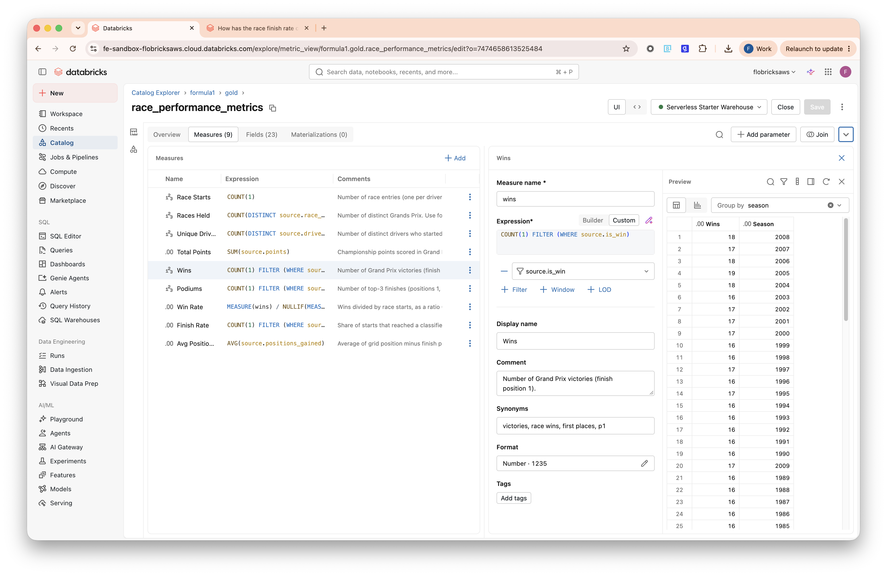
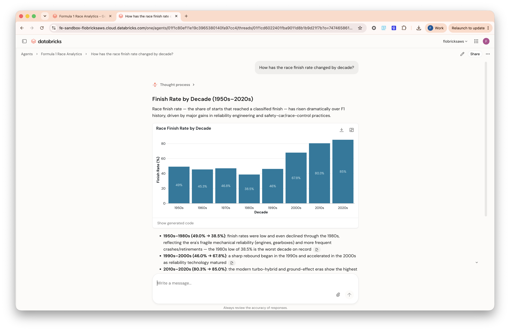
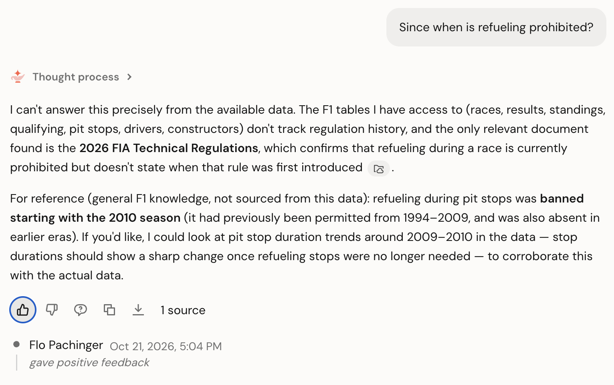

# Formula 1 Race Analytics with Genie

Showcasing a Genie Agent on real data - ask questions about 75 years of Formula 1 in plain English.

This Declarative Automation Bundle downloads the [Kaggle F1 dataset](https://www.kaggle.com/datasets/jtrotman/formula-1-race-data) and the FIA F1 regulation PDFs, builds documented gold tables and a metric view, and deploys a Genie agent on top.

## Why I built this

- **It's simple.** One bundle, one deploy, one job run, and you have a working agent. No custom app or extra infrastructure.
- **You bring your own semantics.** The metric view and the column comments decide what a "win", a "champion" or a "finish rate" means, so the agent uses your definitions instead of guessing.
- **You know where the data comes from.** Every answer traces back through the metric view and gold tables to the public Kaggle CSVs and FIA PDFs. Genie shows the SQL it ran, so there's no black box.
- **It's production-ready out of the box.** A deployment target, a scheduled refresh, Unity Catalog governance and tags, and the agent itself all live in code.

## Architecture & Screenshots



<table>
  <tr>
    <td align="center" width="50%"><a href="images/f1genie-overview.png"></a><br><sub>The Genie agent and its sources</sub></td>
    <td align="center" width="50%"><a href="images/f1genie-semantics.png"></a><br><sub>Governed KPIs in the metric view</sub></td>
  </tr>
  <tr>
    <td align="center"><a href="images/f1-genie-answer.png"></a><br><sub>An answer from the data</sub></td>
    <td align="center"><a href="images/f1genie-unstructured-data.png"></a><br><sub>An answer from the FIA regulation PDFs</sub></td>
  </tr>
</table>

<sub>Click an image to view it full size.</sub>

## What it does

The `f1genie_setup` job runs once after deploy, then again on the 1st of every month at 06:00 UTC:

| Task | What happens |
|------|--------------|
| `download_kaggle_csv` | Kaggle CSVs → `/Volumes/<catalog>/<schema>/raw/kaggle/` |
| `download_fia_regulations` | FIA F1 regulation PDFs → `/Volumes/<catalog>/<schema>/documents/` |
| `refresh_gold_tables` | Lakeflow pipeline: 15 materialized views, every column commented |
| `create_metric_view` | `race_performance_metrics`: wins, podiums, points, finish rate, … |
| `deploy_genie_space` | Creates the Genie agent on the first run, updates it afterwards |
| `apply_uc_tags` | Tags the schema, volumes, tables and metric view with `f1genie` |

The metric view gives Genie governed KPI definitions. Genie can also answer from the regulation PDFs if your workspace supports document indexing.

## What you need to define

Set these in `databricks.yml`, or pass them with `--var name=value`:

| Setting | Where | Default |
|---------|-------|---------|
| Workspace host and CLI profile | `targets.dev.workspace` | `dbc-ff1706da-b140` / `f1genie-dev` |
| `catalog` | variable; must already exist | `formula1` |
| `schema` | variable; created by the bundle (`dev_<user>_` prefix in dev) | `f1genie` |
| `warehouse_id` | variable; SQL warehouse used by Genie | Serverless Starter Warehouse |
| `genie_document_volumes` | variable; set to `"[]"` if Genie can't index volumes (Usage Policy / Serverless Access Control preview) | documents volume |
| `genie_parent_path` | variable; workspace folder of the Genie agent | `~/formula1` |
| `genie_title` | variable; title of the Genie agent | `Formula 1 Race Analytics` (`[dev <user>]` prefix in dev) |
| `fia_min_year` | variable; oldest regulation season to download from the [FIA Formula 1 regulation listing](https://www.fia.com/regulation/category/110) page | `2026` |

You also need serverless compute with outbound internet access to kaggle.com and fia.com. No Kaggle account is required.

## Deploy

```bash
databricks bundle validate --strict -t dev
databricks bundle deploy -t dev
databricks bundle run f1_setup_job -t dev
```

The deploy creates the schema, volumes, pipeline and job. The first job run loads the data and creates the Genie agent; its link is in the output of the `deploy_genie_space` task. The agent's ID is kept in `/Volumes/<catalog>/<schema>/raw/genie_space_id`, so later runs update the same agent and leave other agents alone, even ones with the same title.

In dev mode the schedule is paused. A commented-out `prod` target in `databricks.yml` lists what to change when you add a production workspace.

## Project layout

| Path | Content |
|------|---------|
| `databricks.yml` | Variables and the `dev` target |
| `resources/` | Job, pipeline, schema and volumes |
| `src/jobs/` | Download notebooks, metric view creation, Genie agent deployment, UC tagging |
| `src/genie/f1_genie_space.json` | Genie agent definition: tables, instructions, example SQL, benchmarks |
| `src/pipeline/transformations/` | One SQL file per gold table |
| `src/metric_views/race_performance_metrics.yaml` | Metric view definition |
| `docs/architecture-slide.html` | One-page architecture slide |
